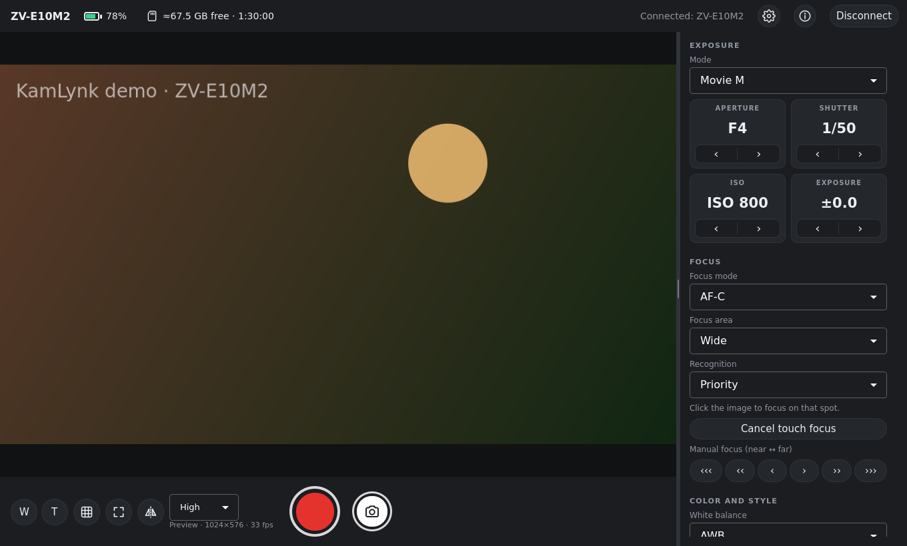

# KamLynk

**English** · [Português](README.pt-BR.md)

Remote control for Sony cameras on Linux: live preview, start/stop recording, exposure
(aperture, shutter, ISO, EV), focus (touch to focus, manual focus), zoom, white balance,
Creative Look/Picture Profile and photo transfer, over Wi-Fi or USB.

Made for the **Sony ZV-E10 II**, but it uses Sony's
[Camera Remote SDK](https://support.d-imaging.sony.co.jp/app/sdk/en/index.html), so other
models supported by the SDK should work too: the interface only shows what the connected
camera reports.



> KamLynk is an independent project. It is **not** made, supported or endorsed by Sony.

## Download and run

1. Download `KamLynk-<version>-x86_64.AppImage` from
   [Releases](https://github.com/dionatansimioni/KamLynk/releases/latest).
2. Make it executable and run it:

   ```bash
   chmod +x KamLynk-*-x86_64.AppImage
   ./KamLynk-*-x86_64.AppImage
   ```

   Or, in your file manager: right-click › Properties › allow running as a program, then
   double-click it.

Runs on any x86_64 distribution with glibc 2.34 or newer: Ubuntu 22.04+, Debian 12+,
Fedora 35+, RHEL/Alma/Rocky 9+, openSUSE Tumbleweed/Leap 16, Arch, Linux Mint 21+ and others.
X11 and Wayland are both supported. No installation is needed; on first start the app adds
itself to your applications menu.

On first start, KamLynk asks you to accept the terms required by Sony's SDK (camera warranty
and prohibited uses, see [THIRD_PARTY_NOTICES.md](THIRD_PARTY_NOTICES.md)).

## Preparing the camera (ZV-E10 II)

**Wi-Fi through your router (recommended)**

1. MENU › Network › Wi-Fi › *Access Point Set.*: connect the camera to the same network as the PC.
2. MENU › Network › Cnct./PC Remote › *PC Remote Function* › **PC Remote: On**.
3. In KamLynk, click *Search for cameras*, then the camera.
4. With **Access Authen.** on (the default), KamLynk asks for the user name and password shown
   in Network › Network Option › Access Authen. Settings. It can remember them in the
   system keychain.

**USB**: MENU › Network › Cnct./PC Remote › *Connection Method*: **USB**. The first time,
click *Allow USB access…* in KamLynk (it installs a udev rule and asks for the administrator
password once).

The app shows these steps too. Menu names may vary slightly with the camera's language.

## Languages

English and Brazilian Portuguese. KamLynk follows the system language (Portuguese systems get
Portuguese, all others English). To change it, open **Settings › Language**; the change
applies immediately.

## Privacy

KamLynk talks only to your camera. It sends no telemetry and does not connect to the internet.

- Preferences and the list of known cameras: `~/.config/KamLynk/kamlynk.ini`
- Log for bug reports: `~/.local/share/KamLynk/kamlynk.log`
- Camera logins ("Remember user name and password") are stored only in the system keychain
  (KWallet / GNOME Keyring), tied to the camera's SSH fingerprint, so a saved login is never
  sent to a different camera. "✕" in the camera list forgets the camera and its login.

## Building from source

Sony does not allow redistributing its SDK, so it is not in this repository. Download
**Camera Remote SDK** for *Linux 64bit (x86)* from
<https://support.d-imaging.sony.co.jp/app/sdk/en/index.html> (KamLynk is tested with
v2.02.00) and accept Sony's license. Then, on Ubuntu/Debian:

```bash
sudo apt install build-essential cmake ninja-build qt6-base-dev qt6-declarative-dev \
    qml6-module-qtquick-controls qml6-module-qtquick-layouts qml6-module-qtquick-window \
    qml6-module-qtquick-dialogs qml6-module-qtqml-workerscript libudev-dev xvfb \
    qt6-svg-dev qt6-wayland qtkeychain-qt6-dev qt6-tools-dev qt6-l10n-tools

./scripts/setup-sdk.sh ~/Downloads/CrSDK_v2.02.00_*_Linux64PC.zip   # copies the SDK to third_party/crsdk
./scripts/build-libxml2.sh          # libxml2.so.2 required by the SDK (first time only)
cmake -S . -B build -G Ninja
cmake --build build
./build/kamlynk                     # real camera
./build/kamlynk --demo              # simulated camera, no hardware needed
```

Tests: `cd build && ctest --output-on-failure`.

### Portable AppImage

```bash
./scripts/build-appimage.sh          # builds in a glibc 2.34 container, runs the tests, creates dist/KamLynk-<version>-x86_64.AppImage
./scripts/test-appimage-distros.sh   # runs the AppImage in containers of several distributions
```

Requires Docker. The build runs in `packaging/portable/Dockerfile` (AlmaLinux 9 /
manylinux_2_34: glibc 2.34, GCC 14, official Qt 6.10, QtKeychain). The glibc 2.34 floor comes
from Sony's SDK binaries. Fallback libraries (a newer libstdc++, GLib, OpenSSL, Kerberos,
libsecret) live in `usr/optional/` and are used only when the system lacks them.

### Translations

Source texts are in Portuguese; the English translation is `i18n/kamlynk_en.ts` (Qt Linguist),
compiled into the executable. After changing UI texts:

```bash
cmake --build build --target update_translations   # adds the new texts to the .ts file
linguist i18n/kamlynk_en.ts                          # translate them (or edit the XML)
```

### Project layout

| Folder | Contents |
|---|---|
| `src/core` | Camera-independent logic (`CameraController`, `CameraProperty`, codecs, `FakeBackend`, `Language`) |
| `src/sdk` | `SonyBackend`: integration with the Sony SDK |
| `src/app` | `main.cpp`, live view item, QML type registration, keychain |
| `qml` | User interface (Qt Quick) |
| `i18n` | Translations |
| `tests` | Unit and UI tests |
| `scripts`, `packaging` | Build, SDK setup and AppImage packaging |

## License

KamLynk's source code is released under the [MIT License](LICENSE).

The AppImage also contains Sony's proprietary Camera Remote SDK libraries, distributed under
Sony's license agreement, and open-source components (Qt under LGPL-3.0, libusb under
LGPL-2.1, QtKeychain, libxml2, libssh2, OpenSSL and others). See
[THIRD_PARTY_NOTICES.md](THIRD_PARTY_NOTICES.md) and [`LICENSES/`](LICENSES).

Sony, ZV-E10 and related names are trademarks of Sony Group Corporation or its affiliates.
