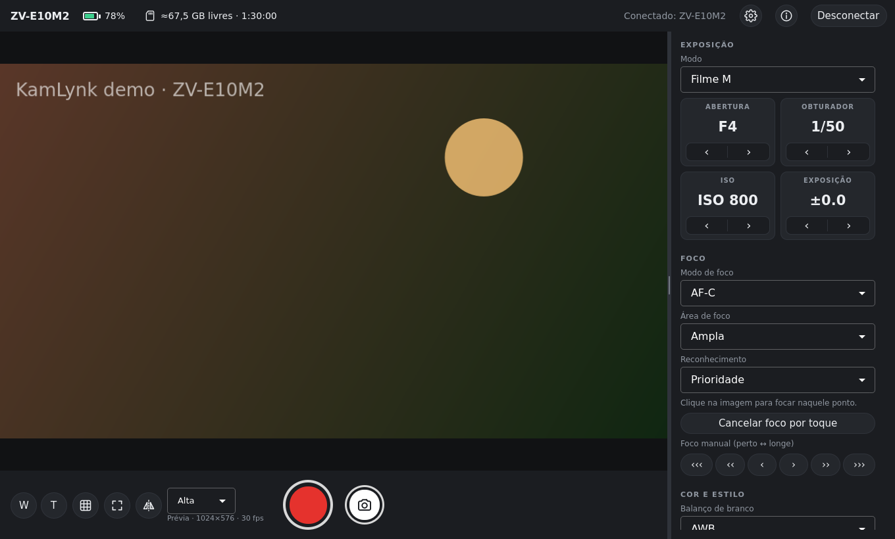

# KamLynk

[English](README.md) · **Português**

Controle remoto para câmeras Sony no Linux: prévia ao vivo, gravar/parar, exposição
(abertura, obturador, ISO, EV), foco (toque para focar, foco manual), zoom, balanço de branco,
Creative Look/Picture Profile e transferência de fotos, por Wi-Fi ou USB.

Feito para a **Sony ZV-E10 II**, mas usa o
[Camera Remote SDK](https://support.d-imaging.sony.co.jp/app/sdk/en/index.html) da Sony, então
os demais modelos suportados pelo SDK também devem funcionar: a interface só mostra o que a
câmera conectada informa.



> O KamLynk é um projeto independente. **Não** é feito, apoiado nem endossado pela Sony.

## Baixar e usar

1. Baixe `KamLynk-<versão>-x86_64.AppImage` em
   [Releases](https://github.com/dionatansimioni/KamLynk/releases/latest).
2. Dê permissão de execução e abra:

   ```bash
   chmod +x KamLynk-*-x86_64.AppImage
   ./KamLynk-*-x86_64.AppImage
   ```

   Ou, no gerenciador de arquivos: botão direito › Propriedades › permitir executar como
   programa, e depois clique duas vezes.

Roda em qualquer distribuição x86_64 com glibc 2.34 ou mais nova: Ubuntu 22.04+, Debian 12+,
Fedora 35+, RHEL/Alma/Rocky 9+, openSUSE Tumbleweed/Leap 16, Arch, Linux Mint 21+ e outras.
Funciona em X11 e Wayland. Não precisa instalar; na primeira execução o app se adiciona ao menu
de aplicativos.

Na primeira execução, o KamLynk pede que você aceite os termos exigidos pelo SDK da Sony
(garantia da câmera e usos proibidos; veja [THIRD_PARTY_NOTICES.md](THIRD_PARTY_NOTICES.md)).

## Preparando a câmera (ZV-E10 II)

**Wi-Fi pelo roteador (recomendado)**

1. MENU › Rede › Wi-Fi › *Conexão do ponto de acesso*: conecte a câmera à mesma rede do PC.
2. MENU › Rede › Conex./Disp. remoto › *Função de disparo remoto* › **Disparo remoto: Ligado**.
3. No KamLynk, clique em *Procurar câmeras* e depois na câmera.
4. Com a **Autent. de acesso** ligada (padrão), o KamLynk pede o usuário e a senha mostrados em
   Rede › Opção de rede › Config. autent. acesso. Ele pode guardá-los no chaveiro do sistema.

**USB**: MENU › Rede › Conex./Disp. remoto › *Método de conexão*: **USB**. Na primeira vez,
clique em *Liberar acesso USB…* no KamLynk (instala uma regra udev e pede a senha de
administrador uma vez).

O app também mostra esses passos. Os nomes dos menus podem variar um pouco conforme o idioma da
câmera.

## Idiomas

Português (Brasil) e inglês. O KamLynk segue o idioma do sistema (sistemas em português abrem em
português; os demais, em inglês). Para trocar, abra **Configurações › Idioma**; a mudança vale
na hora.

## Privacidade

O KamLynk só conversa com a sua câmera. Não envia telemetria e não acessa a internet.

- Preferências e lista de câmeras conhecidas: `~/.config/KamLynk/kamlynk.ini`
- Log para relatar problemas: `~/.local/share/KamLynk/kamlynk.log`
- Logins das câmeras ("Lembrar usuário e senha") ficam só no chaveiro do sistema
  (KWallet / GNOME Keyring), associados à impressão digital SSH da câmera: um login salvo
  nunca é enviado a outra câmera. O "✕" na lista de câmeras esquece a câmera e o login.

## Compilar a partir do código

A Sony não permite redistribuir o SDK, então ele não está neste repositório. Baixe o
**Camera Remote SDK** para *Linux 64bit (x86)* em
<https://support.d-imaging.sony.co.jp/app/sdk/en/index.html> (o KamLynk é testado com a
v2.02.00) e aceite a licença da Sony. Depois, no Ubuntu/Debian:

```bash
sudo apt install build-essential cmake ninja-build qt6-base-dev qt6-declarative-dev \
    qml6-module-qtquick-controls qml6-module-qtquick-layouts qml6-module-qtquick-window \
    qml6-module-qtquick-dialogs qml6-module-qtqml-workerscript libudev-dev xvfb \
    qt6-svg-dev qt6-wayland qtkeychain-qt6-dev qt6-tools-dev qt6-l10n-tools

./scripts/setup-sdk.sh ~/Downloads/CrSDK_v2.02.00_*_Linux64PC.zip   # copia o SDK para third_party/crsdk
./scripts/build-libxml2.sh          # libxml2.so.2 exigida pelo SDK (só na primeira vez)
cmake -S . -B build -G Ninja
cmake --build build
./build/kamlynk                     # câmera real
./build/kamlynk --demo              # câmera simulada, sem hardware
```

Testes: `cd build && ctest --output-on-failure`.

### AppImage portátil

```bash
./scripts/build-appimage.sh          # compila num container glibc 2.34, roda os testes, gera dist/KamLynk-<versão>-x86_64.AppImage
./scripts/test-appimage-distros.sh   # roda o AppImage em contêineres de várias distros
```

Requer Docker. O build acontece em `packaging/portable/Dockerfile` (AlmaLinux 9 /
manylinux_2_34: glibc 2.34, GCC 14, Qt 6.10 oficial, QtKeychain). O piso 2.34 vem dos binários
do SDK da Sony. Bibliotecas de reserva (libstdc++ mais nova, GLib, OpenSSL, Kerberos, libsecret)
ficam em `usr/optional/` e só são usadas quando o sistema não tem a sua.

### Traduções

Os textos do código são em português; a tradução para o inglês fica em `i18n/kamlynk_en.ts`
(Qt Linguist) e é compilada para dentro do executável. Depois de mudar textos da interface:

```bash
cmake --build build --target update_translations   # adiciona os textos novos ao .ts
linguist i18n/kamlynk_en.ts                          # traduza o que faltar (ou edite o XML)
```

### Estrutura

| Pasta | Conteúdo |
|---|---|
| `src/core` | Lógica independente de câmera (`CameraController`, `CameraProperty`, codecs, `FakeBackend`, `Language`) |
| `src/sdk` | `SonyBackend`: integração com o SDK da Sony |
| `src/app` | `main.cpp`, item de live view, registro dos tipos QML, chaveiro |
| `qml` | Interface (Qt Quick) |
| `i18n` | Traduções |
| `tests` | Testes de unidade e da interface |
| `scripts`, `packaging` | Build, preparação do SDK e empacotamento do AppImage |

## Licença

O código do KamLynk é distribuído sob a [licença MIT](LICENSE).

O AppImage também contém as bibliotecas proprietárias do Camera Remote SDK da Sony,
distribuídas conforme o contrato de licença da Sony, e componentes de código aberto (Qt sob
LGPL-3.0, libusb sob LGPL-2.1, QtKeychain, libxml2, libssh2, OpenSSL e outros). Veja
[THIRD_PARTY_NOTICES.md](THIRD_PARTY_NOTICES.md) e [`LICENSES/`](LICENSES).

Sony, ZV-E10 e nomes relacionados são marcas da Sony Group Corporation ou de suas afiliadas.
